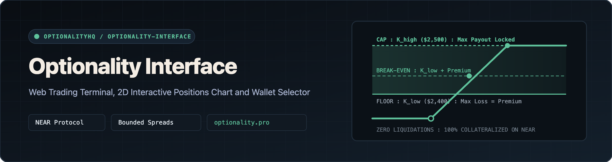
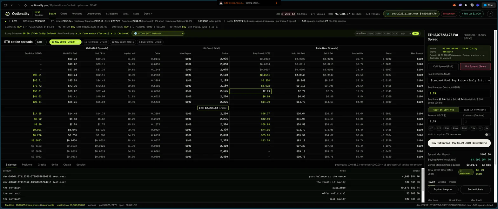
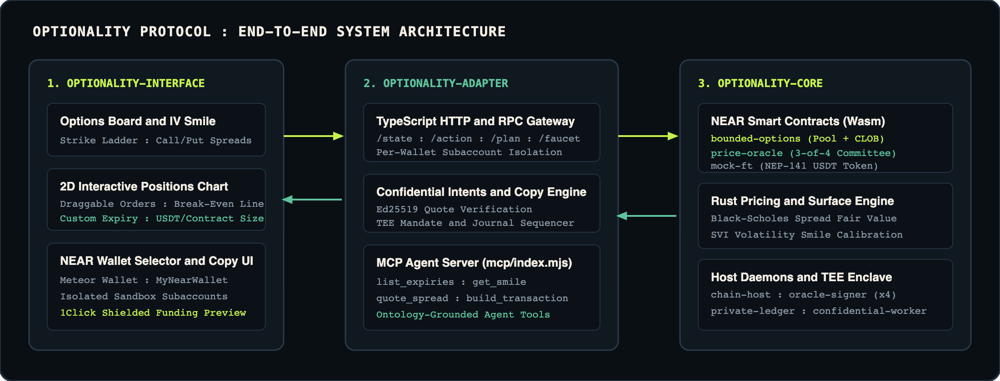
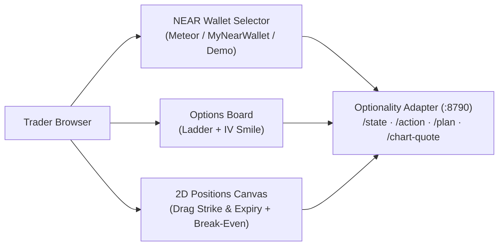

<div align="center">



<br />

[](https://github.com/OptionalityHQ/optionality-interface)
[](https://github.com/OptionalityHQ/optionality-interface)
[](https://github.com/OptionalityHQ/optionality-interface)
[](https://optionality.pro)

**Web Trading Terminal, 2D Interactive Positions Chart, NEAR Wallet Selector & Browser E2E Suite for Optionality**

[Launch Web App](https://optionality.pro) · [Protocol Documentation](https://optionality.pro/docs) · [Semantic Ontology](./docs/ONTOLOGY.md) · [Core Repo](https://github.com/OptionalityHQ/optionality-core) · [Adapter Repo](https://github.com/OptionalityHQ/optionality-adapter)

</div>

---

## Interfaces

- **Web Trading Terminal**: [optionality.pro](https://optionality.pro)
- **Standalone Developer & Protocol Docs**: [optionality.pro/docs](https://optionality.pro/docs)
- **Interactive Views**:
  - **Board**: Strike ladder for BTC & ETH Call/Put spreads, live Bid/Ask/IV columns, volatility smile curve, and 3-of-4 oracle committee health panel.
  - **Chart**: Full-viewport HTML5 Canvas candle/line chart with **2D draggable pending orders** (drag vertically for strike price, horizontally for expiry timestamp), **horizontal Break-Even lines**, custom expiry presets, and dual sizing (**Fractional Contracts** or **USDT Stablecoin Budget**).
  - **Positions & Trade History**: Real-time mark-to-market PnL, break-even badges, early pool/book close actions, and full expired/settled trade history.
  - **Strategies**: Multi-leg payoff simulator and custom strike range builder.
  - **Leaderboard & Private Copy Trading**: CEX-style top trader rankings and 1Click/NEAR Intents confidential copy-trading subscriptions.

<p align="center">
  
</p>

<p align="center">
  
</p>

---

## Key Features & Visual Engineering

### 1. 2D Interactive Positions & Pending Order Canvas (`api/src/positions-chart.ts`)
- **Direct On-Chart Manipulation**: Click anywhere on the price canvas to draft a Call or Put spread, then drag the order line **up/down** to adjust strike price $K$ or drag the expiry handle **left/right** to adjust expiration time $T$ in real time.
- **Per-Position Break-Even Lines**: Every open position and quoted pending order renders a bounded spread band $[K_{\text{low}}, K_{\text{high}}]$ alongside a dashed horizontal **Break-Even line**:
  - **Call Spread**: $\text{BE} = \min(K_{\text{high}},\; K_{\text{low}} + \text{unitCost})$
  - **Put Spread**: $\text{BE} = \max(K_{\text{low}},\; K_{\text{high}} - \text{unitCost})$
- **Multi-Timeframe & Technical Indicators**: Supports `1m`, `5m`, `15m`, `1h`, `4h`, `1D`, `7D`, and `1W` candles with toggleable **EMA**, **SMA**, **Bollinger Bands**, **VWAP**, and **RSI** overlays.
- **Configurable Timezone Engine**: Defaults to the user's local timezone (`Auto Local`, e.g., `UTC+7`) with a global selector spanning `UTC-12` to `UTC+14` synchronized across both the Board and Chart views.

### 2. Official NEAR Wallet Selector & Isolated Sandbox Accounts (`api/src/wallet.ts`)
- Integrates `@near-wallet-selector/core`, `@near-wallet-selector/meteor-wallet`, and `@near-wallet-selector/my-near-wallet` (`v10.1.4`).
- Zero-cost sign-in verification so connecting a wallet never demands a `0.25 NEAR` access-key deposit on every session.
- Each connected wallet receives its own isolated on-chain subaccount and independent balance/position state via the gateway adapter.



---

## 🗂 Directory Structure

| Path | Contents |
| :--- | :--- |
| [`api/src/positions-chart.ts`](./api/src/positions-chart.ts) | Interactive HTML5 Canvas chart, 2D draggable pending orders, break-even renderer, and position popup inspector. |
| [`api/src/chart-canvas.ts`](./api/src/chart-canvas.ts) | Low-level canvas drawing primitives, spread bands, and high-DPI coordinate transforms. |
| [`api/src/chart-navigation.ts`](./api/src/chart-navigation.ts) | Pointer zoom/pan physics and axis clamping. |
| [`api/src/candles.ts`](./api/src/candles.ts) | Historical + live candle aggregation and Coinbase/exchange fallback feeds. |
| [`api/src/indicators.ts`](./api/src/indicators.ts) | EMA, SMA, Bollinger Bands, VWAP, and RSI indicator calculations. |
| [`api/src/wallet.ts`](./api/src/wallet.ts) | Official NEAR Wallet Selector adapter (Meteor Wallet, MyNearWallet, and demo switcher). |
| [`sim/demo-template.html`](./sim/demo-template.html) | Unified single-page application template (Board, Chart, Positions, Strategies, Leaderboard, Copy Trading). |
| [`sim/build-demo.mjs`](./sim/build-demo.mjs) | Esbuild bundler that compiles `wallet.js`, `positions-chart.js`, and `demo/index.html`. |
| [`demo/`](./demo) | Compiled production static assets (`index.html`, `landing.html`, `docs.html`, `images/`, `media/`). |
| [`sim/e2e.mts`](./sim/e2e.mts) | Playwright end-to-end browser verification suite. |
| [`docs/ONTOLOGY.md`](./docs/ONTOLOGY.md) | Source-grounded UI & domain ontology specification. |

---

## Quickstart

### 1. Install & Build Static Bundle

```bash
git clone https://github.com/OptionalityHQ/optionality-interface.git
cd optionality-interface
npm install
npm run build
```

Expected output:

```text
wrote demo/index.html (229.9 KiB) · served by the gateway at /
```

### 2. Run Chart, Navigation & Indicator Unit Tests

```bash
npm test
```

Expected output:

```text
✔ history pages pass their ending timestamp and never return candles beyond it
✔ Coinbase history fallback sends a bounded range and sorts before limiting
✔ a missing feed produces a gap rather than fabricated historical prices
✔ presentation time advances between market updates and resets after clock jumps
✔ zoom preserves the pointer value and clamps the span
✔ pan translates the window without changing its scale
✔ an entered strike never silently changes side, expiry, or price
✔ spread moneyness follows both strikes and caps at its width
✔ chart orders accept only bounded whole contract quantities
✔ EMA and SMA compute expected moving averages
✔ Bollinger Bands expand on volatility and collapse on flat series
✔ VWAP weights price by candle volume
✔ RSI stays bounded between 0 and 100
✔ createSmoothValue interpolates smoothly toward target and snaps after gaps
ℹ tests 14 | pass 14 | fail 0
```

### 3. Run End-to-End Browser Verification

With the gateway running on `http://127.0.0.1:8790`:

```bash
npm run e2e
```
