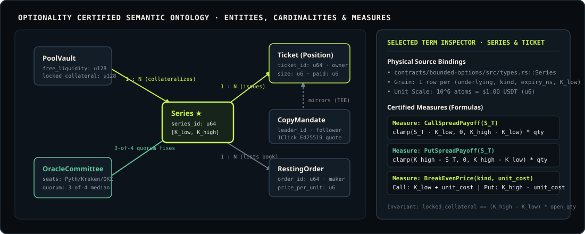

# Optionality Protocol — Source-Grounded Semantic Ontology

> Modeled using the **Auto-Ontology** source-grounded methodology: Question Contracts, Entity Terms with exact physical source bindings, Relationship Contracts with cardinality and fanout guarantees, and Certified Measure Contracts with explicit units, grains, and counterexamples.

  

---

## 1. Question Contracts

Before any UI panel, API route, or MCP tool answers a trader or agent question, it resolves against the certified questions below:

| ID | Representative Question | Target Population | Grain | Required Measures | Exclusions / Counterexamples |
| :--- | :--- | :--- | :--- | :--- | :--- |
| **Q1** | *"What does it cost right now to protect 10 ETH against a drop from $2,400 to $2,300 before 00:00 UTC?"* | Open `Series` where `underlying = "ETH"`, `kind = "Put"`, `K_high = 2400`, `K_low = 2300` | Per `(series_id, quantity)` | `PoolAskPrice`, `BestBookAsk`, `MaxPayout`, `BreakEvenPrice` | Expired series (`now_ns >= accept_until_ns`) or unquoted series (`quote_valid == false`) fail closed. |
| **Q2** | *"Why is my open Call spread in profit or loss right now, and where is my break-even?"* | Open `Ticket` rows owned by `account_id` (`settled == false`, `size > 0`) | Per `ticket_id` | `UnitEntryCost`, `BreakEvenPrice`, `LiveMarkValue`, `UnrealizedPnL` | Never compare a Call spread mark to a single-leg spot threshold without subtracting entry premium. |
| **Q3** | *"Can the LP vault ever default if BTC or ETH moves 50% in one candle?"* | `PoolVault` state across all active `Series` | Venue-wide | `VaultLockedCollateral`, `WorstCaseSpreadLiability`, `FreeLiquidity` | Unbounded naked options are rejected at series creation (`high_strike > low_strike` strictly enforced). |
| **Q4** | *"Did the oracle committee reach an honest settlement price at expiry?"* | `OracleCommittee` reports for `(feed_id, expiry_ns)` | Per `(series_id, seat_signer)` | `SeatCount`, `MedianSettlementPrice`, `ConfidenceBps` | Duplicate submissions from a single seat are deduplicated by signer ID; fewer than 3 distinct seats cannot finalize normal settlement. |

---

## 2. Certified Entity Terms & Physical Bindings

| Term | Business Definition | Physical Source Binding | Primary Key & Grain | Unit / Encoding |
| :--- | :--- | :--- | :--- | :--- |
| **`Series`** | A bounded European call or put spread with fixed floor strike $K_{\text{low}}$, cap strike $K_{\text{high}}$, and expiry $T$. | `core::contracts/bounded-options/src/types.rs::Series` | `series_id: u64` — 1 row per `(underlying, kind, expiry_ns, low_strike, high_strike)` | Strikes in $u_6$ USD atoms ($10^6 = \$1.00$); timestamps in nanoseconds (`u64`). |
| **`Ticket`** | An on-chain option position minted to a trader upon buying from the LP Pool Vault or matching a resting ask on the order book. | `core::contracts/bounded-options/src/types.rs::Ticket` | `ticket_id: u64` — 1 row per position issuance | `size` in $10^{-4}$ fractional contract lots ($10{,}000 = 1.0000\text{ ct}$); `paid` in $u_6$ USDT atoms. |
| **`PoolVault`** | Unified NEP-141 USDT liquidity pool that quotes two-sided spread markets and locks 100% of maximum spread payout at trade inception. | `core::contracts/bounded-options/src/lib.rs::Contract` | Singleton per deployment (`free_liquidity`, `locked_collateral`, `lp_shares`) | $u_6$ USDT atoms (`u128`). |
| **`RestingOrder`** | A limit bid or collateralized limit ask resting on a series order book. | `core::contracts/bounded-options/src/types.rs::Order` | `(series_id: u64, order_id: u64)` | `price_per_unit` in $u_6$ USDT atoms per contract. |
| **`OracleCommittee`** | Four independent market-data signers (Pyth, Kraken, OKX, Venue Index), each running in an isolated OS process with its own Ed25519 key. | `core::contracts/price-oracle/src/lib.rs::PriceOracle` | `(feed_id: String, signer: AccountId)` | Price in $u_6$ USD atoms; confidence in basis points (`u16`). |
| **`WalletSubaccount`** | Dedicated on-chain NEAR subaccount provisioned per external wallet so balances, open tickets, and trade histories are strictly isolated. | `adapter::api/src/chain.ts::Chain::ensureWalletRole` | `w-<slug>-<hash4>.<admin>` mapped 1:1 to `displayAccount` | $u_6$ USDT venue balance + NEAR gas allowance. |
| **`CopyMandate`** | Confidential copy-trading subscription linking a follower to a leader strategy with 1Click/NEAR Intents Ed25519-verified shielded funding. | `core::private-ledger/src/lib.rs` & `adapter::api/src/copy-trading.ts` | `mandate_id: String` — 1 row per `(follower, leader_id)` | Allocation in USD; max drawdown in bps. |

---

## 3. Relationship Contracts

| Relationship | Source $\rightarrow$ Target | Multiplicity | Join Key | Fanout & Integrity Contract |
| :--- | :--- | :--- | :--- | :--- |
| **`PoolVault collateralizes Series`** | `PoolVault` $\rightarrow$ `Series` | `1 : N` | Singleton $\rightarrow$ `series.settled == false` | Sum of `series.pool_locked` across all open series equals `PoolVault.locked_collateral`. Never sum `PoolVault.free_liquidity` across series rows (fanout error). |
| **`Series issues Ticket`** | `Series` $\rightarrow$ `Ticket` | `1 : N` | `series.series_id == ticket.series_id` | Every `Ticket` references exactly one `Series`. Marks must be read from the ticket's own `(series_id, expiry_ns)` cell, never from whichever expiry tab is currently selected in the UI. |
| **`Series lists RestingOrder`** | `Series` $\rightarrow$ `RestingOrder` | `1 : N` | `series.series_id == order.series_id` | Bids and asks are partitioned by side; asks lock $(\text{width} - \text{ask\_price}) \times \text{size}$ from the writer at placement. |
| **`OracleCommittee fixes Series`** | `OracleCommittee` $\rightarrow$ `Series` | `4 : 1` | `oracle.feed_id == series.oracle_feed` within `[expiry_ns, accept_until_ns]` | Requires $\ge 3$ distinct seat AccountIds before computing the median settlement price $S_T$. |
| **`WalletSubaccount owns Ticket`** | `WalletSubaccount` $\rightarrow$ `Ticket` | `1 : N` | `subaccount.account == ticket.owner` | Two distinct browser wallets never resolve to the same on-chain `ticket.owner`. |

---

## 4. Certified Measure Contracts (Formulas & Invariants)

### 4.1 Spread Width & Locked Collateral
* **Width per Contract**:
  $$W = K_{\text{high}} - K_{\text{low}} \quad (\text{where } K_{\text{high}} > K_{\text{low}})$$
* **Maximum Payout / Locked Collateral**:
  $$\text{MaxPayout}(q) = W \times q$$
  When the LP Pool sells $q$ contracts at unit premium $p$, the trader pays $p \times q$ and the pool locks $(W - p) \times q$, so the full $W \times q$ is held in escrow inside the contract before the transaction finishes.

### 4.2 Terminal Payoff at Expiry ($S_T$)
* **Bounded Call Spread Payoff**:
  $$\text{Payoff}_{\text{Call}}(S_T, q) = \min\!\big(W,\; \max(0,\; S_T - K_{\text{low}})\big) \times q$$
* **Bounded Put Spread Payoff**:
  $$\text{Payoff}_{\text{Put}}(S_T, q) = \min\!\big(W,\; \max(0,\; K_{\text{high}} - S_T)\big) \times q$$

### 4.3 Break-Even Price ($	ext{BE}$)
* **Unit Entry Cost**: $c = \frac{\text{paid}}{q}$
* **Call Spread Break-Even**:
  $$\text{BE}_{\text{Call}} = \min\!\big(K_{\text{high}},\; K_{\text{low}} + c\big)$$
* **Put Spread Break-Even**:
  $$\text{BE}_{\text{Put}} = \max\!\big(K_{\text{low}},\; K_{\text{high}} - c\big)$$

### 4.4 Pool Mid & Ask Pricing (Black-Scholes Spread + Utilization Skew)
* **Theoretical Spread Fair Value**:
  $$V_{\text{CallSpread}} = C_{\text{BS}}(S, K_{\text{low}}, T, \sigma(K_{\text{low}})) - C_{\text{BS}}(S, K_{\text{high}}, T, \sigma(K_{\text{high}}))$$
  $$V_{\text{PutSpread}} = P_{\text{BS}}(S, K_{\text{high}}, T, \sigma(K_{\text{high}})) - P_{\text{BS}}(S, K_{\text{low}}, T, \sigma(K_{\text{low}}))$$
* **Pool Ask Price**:
  $$P_{\text{ask}}(q) = \min\!\Big(W - 10^{-6},\; V_{\text{spread}} \times (1 + \text{fee}_{\text{bps}} + \text{skew}(u))\Big)$$
  where $\text{fee}_{\text{bps}} = 50\text{ bps}$ ($0.50\%$) for liquid tickets and $0\text{ bps}$ for held-to-expiry tickets (`hold = true`).
